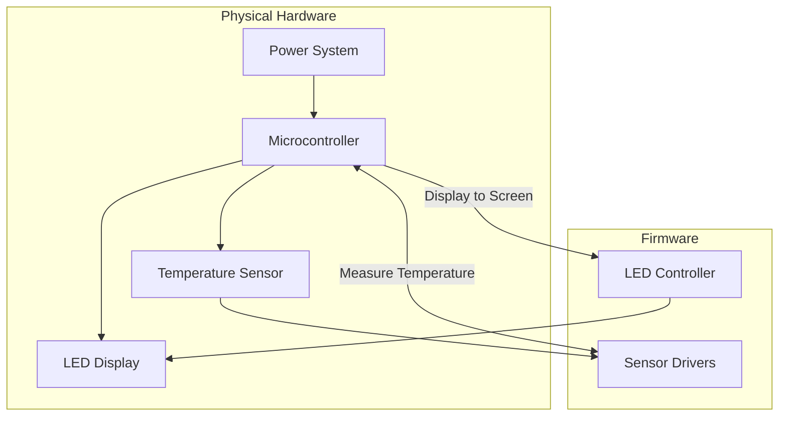

# A-DIY-Thermometer
Have you ever thought that it would a sigificantly better idea to build your own thermometer rather than going to the drug store and spending the five dollars to buy one? Me neither. However, when you need a temperature reading for a control system, you have to learn how to build your own, so let's get started off with the basics then.

## Overview of Hardware Functionality

## Project Structure Tree
DIYThermometer/
├── docs/
│ ├── hardware/
| |  ├── architecture.md
| |  ├── wiring.md
| |  └── serial-protocol.md
│ └── requirements.md
├── firmware/
│ ├── src/
| |  ├── main.ino
| |  ├── temp.ino
| |  └── LED.ino
│ └── tests/
│   ├── test_LED.ino
│   └── test_temp.ino
├── README.md
└── LICENSE

## License
  This is obviously a copyleft document so that people have a base to build off of to learn temperature readings.
